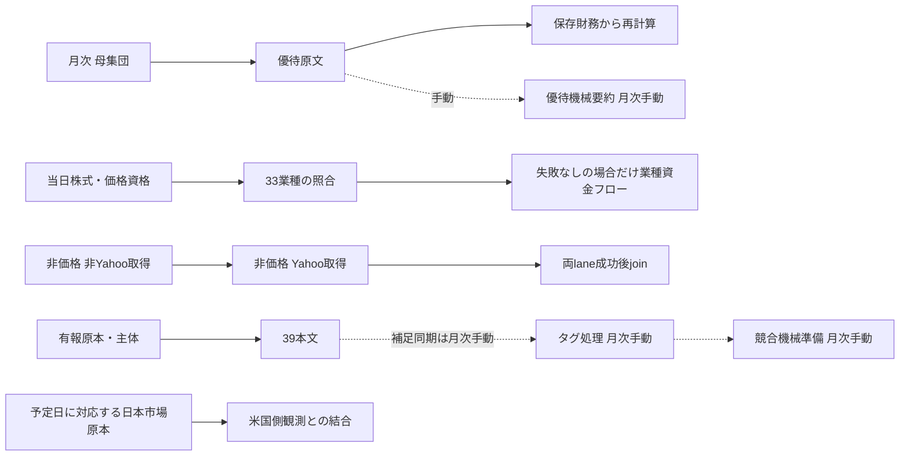

# 本番定期処理とSSH補完

確認日: 2026-10-23。予定時刻・先行条件・LLM利用の正本は[READMEの定期処理表](../README.md#本番の定期処理先行条件llm利用)。機能・取得元・手動/停止/未実装の全件は[データ一覧](batch-data-inventory.md)。日次の本体はGitHub Actions。Mac自動起動は廃止し、旧担当機能は[月次手動](mac-monthly-manual.md)へ。SSHのnipogiは有限補完用。

## 起動と担当

| 担当 | 起動元 | 実行する処理 | 重複させない境界 |
|---|---|---|---|
| Cloudflare | 14 Cron Trigger | 株式・VWAP・独立資金フロー・開示補完・マクロのdispatch/既存期限確認、信用残・日証金・Python開示のdispatch | receiptを条件付き確保。同じ予定を自動再送しない |
| Actions `stock-sync.yml` | CF dispatch／月次schedule | 株式・金融指標→33業種→条件付き業種資金フロー。別targetでマクロ／月次母集団・優待・再計算 | `stock-sync`と`yahoo-source`。金融資格・保存失敗を後続へ持ち越さない |
| Actions `vwap-ingest.yml` | CF dispatch | 日足→5分足、または信用残 | 日足・5分足は段階間で`yahoo-source`を解放し、同run/attempt受付を継承。信用残は専用排他。日足exit2は5分足を開始しない |
| Actions `moneyflow.yml` | CF dispatch／株式成功後のworkflow_call | 非価格28取得元、または価格依存の業種資金フロー | 2経路のtargetを分離。閉鎖済み非Yahoo→独立Yahoo→両lane成功時のjoin。不明結果なら後続停止 |
| Actions `catchup.yml` | CF dispatch | TDnet→Node有報・保有明細 | 共通資格・保存設定が成功した場合は、TDnet失敗でも独立したEDINETを実行。取消・資格失敗では停止。Linuxのbiztag定期writerは停止 |
| ActionsのPython処理 | CF dispatch: `supply_daily.yml`／`tdnet_hourly.yml`／`edinet_daily.yml`、月次schedule: `master_sync.yml` | 日証金、TDnet速報、財務サマリ、公式提出者マスタ | 予定日時・受付/追加IO締切と各原本の日付・主体・writer契約を検査 |
| Actionsの監視 | `ops_check.yml`（日次）／`cloud_check.yml`（手動）／CF期限確認 | 鮮度・実run・schema・公開資格・配備 | 監視は取得失敗でも実行。自動的な再取得で埋めない |
| 旧Mac LaunchAgent | **2labelともdisable＋bootout済み** | 本文補足同期・タグ・競合準備・優待要約は月次手動 | state・未完intent・モデル・原本・旧receiptを保持。自動再開しない |
| SSH nipogi | 対象・入力・期限を固定した手動補完 | 通常CLIによる価格・保有・原本等の不足補完 | kabulab-cf用のSSH日次cronは登録していない。定期writerと競合させない |

GitHubのYAMLは14本、宣言21 jobs。有効13本／20 jobsで、歴史RAW全量用`raw_index_backfill.yml`の1 jobだけ意図的無効。`backfill.yml`・`roa_saved_raw_publish.yml`は手動用で、日次起動ではない。予定日時・受付・締切の正本は[時刻契約](stock-scheduler.md#取得処理の時刻契約)。実績は[10/22の稼働確認](test-logs/recovery-functional-status-20261022.md)を参照。

## 先行関係



33業種stepは現workflowの実行順であり、資金フローの価格計算自体は`core_stocks.sector`を参照する。価格非依存28取得元は株式同期を待たない。月次再計算は未来の18時同期を待たず、欠測や日付不一致を理由付きで扱う。

Yahoo取得は`yahoo-source`で直列化し、429/503の期限をD1で共有する。Notionのpacingは各プロセス内であり、全job共通の上限ではない。取得の追加並列化をせず、復旧writerは定期と通信枠・保存先を調整する。原本の保存結果不明や未閉鎖intentは再送しない。

## SSHでの不足補完

SSHは`/home/sora/projects/kabulab-cf`、ホスト名`nipogi`。mainをfast-forwardし、実行中の処理は専用のdetached runtimeとprivate `.env`に固定する。実行途中にsource・設定・lockを切り替えない。Nix・Node・pnpm・Pythonと依存lockは本番CLIと同じものを使う。

```sh
nix --extra-experimental-features 'nix-command flakes' develop --offline --no-write-lock-file --command env -u NODE_PATH node --import tsx scripts/vwap/ingest-intra.ts --range=5d
```

`env -u NODE_PATH`はNix環境へ入った後に置く。秘密値はprivate `.env`だけへ保存する。R2資格は既存raw/vwap bucket範囲で、全処理の設定が揃ったとは扱わない。Apple SiliconのClef/MPSをLinuxへ移さない。本文の明示`--mechanical-only`はLinuxでも同じCLIで実行できる。

| 補完 | 通常入口・制約 |
|---|---|
| VWAP | `ingest:vwap-daily`／`ingest:vwap-intra`。一般5分足は銘柄＋最大60日。過去の任意時刻は専用の固定対象契約のみ |
| 信用残 | `ingest:vwap-margin --date=YYYYMMDD`。公開元に残る原本が必要 |
| Python有報 | Nix内の`pipeline`から`uv run python -m jp_stock_pipeline.jobs.edinet_daily --date YYYY-MM-DD --require-cloud` |
| 月次 | `sync:universe`→`yutai:fetch`→`sync:monthly:core`。`sync:monthly`は優待取得→再計算だけ。要約は月次手動 |
| 保有価格 | `scripts/notion/shareholdings.ts resume-prices <private-output.json>`。通常queue・固定window・原本/basis/主体検査を使用 |
| 39本文 | `biztag run --mechanical-only --codes=<固定対象> --limit=<同数> --budget-min=<分>`。新規/変更入力の意味判定は保留 |

当日の株式同期には任意過去日・一般的な銘柄指定再開を加えていない。過去41社の保存原本補完は[別の固定受入](test-logs/stock41-financial-replay-20261018.md)。全履歴RAWミラー・全市場再取得・月次の一括再実行は不足補完の先行条件ではない。

## 既知の誤解

- 日足停止は「#411が未配備」ではなく、10/16の実Cronで旧時刻guardが秒を拒否した記録がある。通常guardは修正済み。10/15木曜は月水金Cronの対象外。
- Node有報の旧16件は、保存logでは主体未解決。件数上限に到達した16件ではない。
- 設定有効、自然時刻の成功、全データ充足は別の受入。旧receiptを新revision成功へ書き換えない。

詳細な実測・旧操作履歴は[10/18の受入記録](test-logs/production-dependencies-mechanical-20261018.md)、[10/19の復旧記録](test-logs/recovery-functional-status-20261019.md)とGit履歴を参照。
