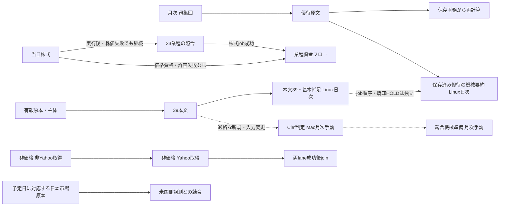

# 本番定期処理とSSH補完

確認日: 2026-10-26。予定時刻・先行条件・LLM利用の正本は[READMEの定期処理表](../README.md#本番の定期処理先行条件llm利用)。機能・取得元・手動/停止/未実装の全件は[データ一覧](batch-data-inventory.md)。日次の本体はGitHub Actions。本文39・基本補足・優待機械要約は[Linux日次](mechanical-publishing.md)へ分離し、共有状態移行・有限本番確認後に有効化済み。初回Actionsは本文31社同期/今回未着手19・優待60件保留/適用0・モデル0でFAILURE終了し、[受入台帳](work-plans/production-completion-20261025.md)へ分離する。Mac自動起動は廃止を維持し、Clef判定・競合入力準備は[月次手動](mac-monthly-manual.md)。SSHのnipogiは有限補完用。

## 起動と担当

| 担当 | 起動元 | 実行する処理 | 先行条件・重複防止 | LLM |
|---|---|---|---|---|
| Cloudflare | 14 Cron Trigger | 株式・VWAP・独立資金フロー・開示補完・マクロのdispatch/既存期限確認、信用残・日証金・Python開示のdispatch | `main`へ起動。receiptを条件付き確保し、同じ予定を自動再送しない | なし |
| Actions `stock-sync.yml` | CF dispatch／毎月10日10:30 | 株式・金融指標→33業種→条件付き業種資金フロー。別targetでマクロ／月次母集団・優待原文・再計算 | `stock-sync`と`yahoo-source`。33業種は株価失敗でも実行。資金フローは価格資格・株式job成功・許容失敗なしが必要 | なし |
| Actions `vwap-ingest.yml` | CF dispatch | 日足→5分足、または信用残 | 段階間で`yahoo-source`を解放し、同run/attempt受付を継承。信用残は専用排他。日足exit2・原本未閉鎖では5分足を開始しない | なし |
| Actions `moneyflow.yml` | CF dispatch／株式成功後のworkflow_call | 独立28取得元、または価格依存の業種資金フロー | 閉鎖済み非Yahoo→独立Yahoo→両lane成功時のjoin。既知のsource失敗と保存結果不明を区別し、不明なら後続停止 | なし |
| Actions `catchup.yml` | CF dispatch | TDnet→Node有報・保有明細 | 共通資格・保存設定が成功すればTDnet失敗でもEDINETを実行。取消・資格失敗では停止。旧biztag定期writerは停止 | なし |
| ActionsのPython処理 | CF dispatch: `supply_daily.yml`／`tdnet_hourly.yml`／`edinet_daily.yml`、毎月1日06時: `master_sync.yml` | 日証金、TDnet速報、財務サマリ、公式提出者マスタ | 予定日時・受付/追加IO締切と各原本の日付・主体・writer契約を検査 | なし |
| Actions `mechanical-publishing.yml` | 毎日04:17、有効化済み | 保存済み本文39・基本補足（最大50社）→優待機械要約（最大60群） | 本文の既知HOLDでも独立した優待へ進む。共有owner/pendingが未閉鎖なら後続の依存生成前に停止。原文取込・Macとも同じR2共有writer | なし |
| Actionsの監視 | `ops_check.yml`（日次）／`cloud_check.yml`（手動）／CF期限確認 | 鮮度・実run・schema・公開資格・配備 | 取得失敗でも判定を実行。自動的な再取得で埋めない | なし |
| Mac月次手動 | Calendar予定＋メール通知のコマンド | 適格新規/実入力変更のClef判定、競合入力準備 | 旧LaunchAgentの2labelはdisable＋bootout。受入済みruntime・state・未完intent・原本を保持し、共有writerを使用 | Clef判定のみあり |
| SSH nipogi | 対象・入力・期限を固定した手動補完 | 本番と同じ通常CLIで価格・保有・原本等を補完 | kabulab-cf用のSSH日次cronは未登録。定期writerと競合させない | なし |

10/26 02:05ZのGitHub公式一覧は16 workflow（repo内YAML15本＋GitHub生成Dependency Graph1本）。repo内は宣言23 jobsで、歴史RAW全量用`raw_index_backfill.yml`の1 jobを意図的無効とし、14 workflowがactive（宣言22 jobs、機械publisher2 jobsを含む）。これはCI・手動・条件付き/退役案内を含む宣言数で、自動実行job数ではない。`MECHANICAL_PUBLISHING_ENABLED=true`は読戻し済み。`backfill.yml`・`cloud_check.yml`・`roa_saved_raw_publish.yml`は手動用。予定日時・受付・締切の正本は[時刻契約](stock-scheduler.md#取得処理の時刻契約)。設定有効・自然定期の成功・全データ充足は別に確認する。

時刻契約を持つActions CLIは、`record-job-clock`が取得した元jobの実開始時刻を使い、段階ごとのCLI開始でnative上限を延長しない。固定JST締切とnative終了前の余裕を両方守り、新source停止後も取得済み原本の保管・照合をhardまで進める。機械publisherは各job30分、hardは「CLI開始＋元budget＋5分」と「job実開始＋25分」の早い方、softはhardの5分前。clock欠落・残時間不足では共有owner取得前に停止する。HTTPとR2も同じhardを使い、送信済み結果不明は未完のまま保持する。

## 先行関係



33業種は株式stepの実行後に更新し、株価・RSIの失敗では停止しない。株式対象外・取消時は実行せず、同じjobのYahoo排他とNotion通信枠を維持する。資金フローの価格計算自体は`core_stocks.sector`を参照し、株式・33業種の失敗や価格欠測では後続を開始しない。価格非依存28取得元は株式同期を待たない。月次再計算は未来の18時同期を待たず、欠測や日付不一致を理由付きで扱う。

Yahoo取得は`yahoo-source`で直列化し、429/503の期限をD1で共有する。Notionのpacingは各プロセス内であり、全job共通の上限ではない。取得の追加並列化をせず、復旧writerは定期と通信枠・保存先を調整する。原本の保存結果不明や未閉鎖intentは再送しない。

本文補足の機械同期は選択済み文書のD1主体・doc/FY・pointer・状態と、Notion所属・7メタ・全文を確認する。原文SHA・Notion表現SHA・旧receipt・現在targetが一致する場合だけ書込を省く。同じ文字数の変更も再同期し、旧タグ根拠は本文と分けて保持する。上流ZIPの再取得・モデル呼出しは行わない。

## SSHでの不足補完

SSHは`/home/sora/projects/kabulab-cf`、ホスト名`nipogi`。mainをfast-forwardし、実行中の処理は専用のdetached runtimeとprivate `.env`に固定する。実行途中にsource・設定・lockを切り替えない。Nix・Node・pnpm・Pythonと依存lockは本番CLIと同じものを使う。

```sh
nix --extra-experimental-features 'nix-command flakes' develop --offline --no-write-lock-file --command env -u NODE_PATH node --import tsx scripts/vwap/ingest-intra.ts --range=5d
```

`env -u NODE_PATH`はNix環境へ入った後に置く。秘密値はprivate `.env`だけへ保存する。R2資格は既存raw/vwap bucket範囲で、全処理の設定が揃ったとは扱わない。Apple SiliconのClef/MPSをLinuxへ移さない。本文補足・優待の機械同期もLinuxで同じ`sync:mechanical`入口を使用する。

| 補完 | 通常入口・制約 |
|---|---|
| VWAP | `ingest:vwap-daily`／`ingest:vwap-intra`。一般5分足は銘柄＋最大60日。過去の任意時刻は専用の固定対象契約のみ |
| 信用残 | `ingest:vwap-margin --date=YYYYMMDD`。公開元に残る原本が必要 |
| Python有報 | Nix内・repo直下から`uv run --frozen --env-file .env --project pipeline python -m jp_stock_pipeline.jobs.edinet_daily --date YYYY-MM-DD --require-cloud` |
| 月次 | `sync:universe`→`yutai:fetch`→`sync:monthly:core`。`sync:monthly`は優待取得→再計算だけ。原文取込も共有writerの初回移行が必要で、要約は独立Linux日次 |
| 保有価格 | `scripts/notion/shareholdings.ts resume-prices <private-output.json>`。通常queue・固定window・原本/basis/主体検査を使用 |
| 本文39・基本補足 | `sync:mechanical --target=supplement --codes=<固定対象> --limit=<同数> --budget-min=<分>`。最大50社、保存原本の資格を確認。新規/変更入力の意味判定は保留 |
| 優待機械要約 | `sync:mechanical --target=yutai --limit=<60以下> --budget-min=<15以下> --state-dir=<private-dir>`。共有writerと既存validatorを使い、モデルなし |

当日の株式同期には任意過去日・一般的な銘柄指定再開を加えていない。過去41社の保存原本補完は[別の固定受入](test-logs/stock41-financial-replay-20261018.md)。全履歴RAWミラー・全市場再取得・月次の一括再実行は不足補完の先行条件ではない。

## 既知の誤解

- 日足停止は「#411が未配備」ではなく、10/16の実Cronで旧時刻guardが秒を拒否した記録がある。通常guardは修正済み。10/15木曜は月水金Cronの対象外。
- Node有報の旧16件は、保存logでは主体未解決。件数上限に到達した16件ではない。
- 設定有効、自然時刻の成功、全データ充足は別の受入。旧receiptを新revision成功へ書き換えない。

詳細な実測・旧操作履歴は[10/18の受入記録](test-logs/production-dependencies-mechanical-20261018.md)、[10/19の復旧記録](test-logs/recovery-functional-status-20261019.md)とGit履歴を参照。
