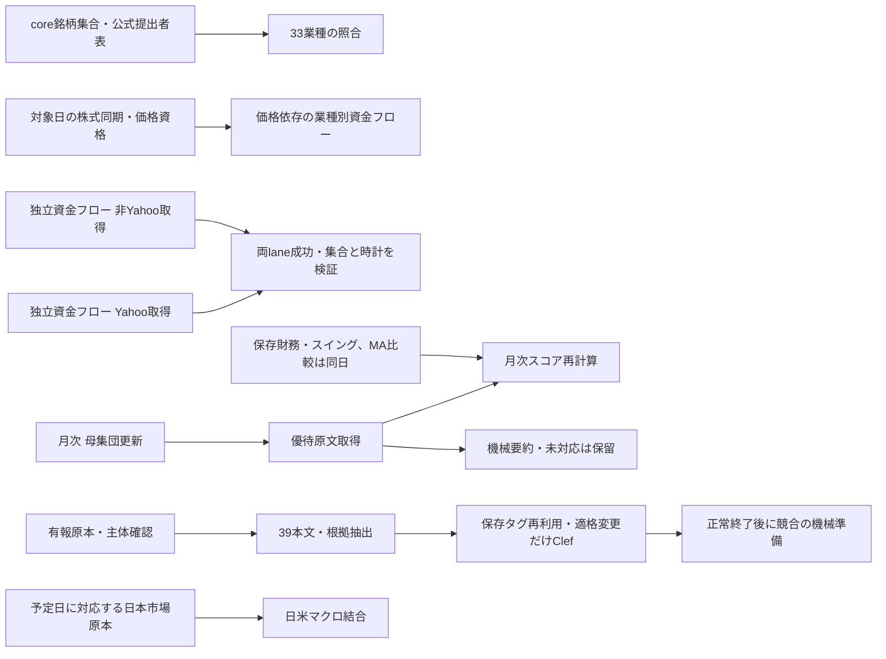

# 本番定期処理とSSHでの補完

確認日: 2026-10-18。本番コードmain532 `cc11b8b2` はCI・実CF配備・10triggerを受入済み。Mac定期runtimeは529を保持。SSH保有価格補完は閉鎖し、固定41銘柄の財務・指標補完もmain532で受入済み。
時刻はJST、Cloudflareは起動・結果監視、重い取込本体はActionsまたはMacで実行する。
設定上の予定と、実行成功・全銘柄のデータ充足は別に確認する。

| 処理 | 予定時刻・頻度 | 必要な先行条件・順序 | LLM利用（定期実行） | 本体と保存先 | SSH/Linuxでの実行・過去分 |
|---|---|---|---|---|---|
| 日証金の貸借・需給 | 平日12:17 | 公表済みの当日CSV。株式同期の完了待ちは不要 | なし | `supply_daily.yml` / Python → Notion・D1・R2 | 実行可能。通常CLIは公表中のCSVを取得し、任意の過去CSVを取り直す機能ではない |
| VWAP日足・5分足 | 月水金17:00、CF起動 | 公式銘柄表・対象日の原本資格。Yahoo共通排他内で日足→5分足、結果不明では後続停止 | なし | `vwap-ingest.yml` → `ingest:vwap-daily`、`ingest:vwap-intra` → R2、原本Notion | 日足は10年窓。一般5分足は銘柄＋1〜60日窓。任意from/toは既存422回復の固定5銘柄だけ。同じwriterを重複起動しない |
| 市場の信用残高 | 平日17:00 | 公表元の対象日資料。株価とのデータ依存はないが、現在はVWAPと共通workflow排他 | なし | 同workflowの`ingest:vwap-margin` → R2、原本Notion | `--date=YYYYMMDD`対応、公開元に原本が残る日だけ |
| 株価・財務断面・RSI・スイング・モメンタム・業種騰落 | 平日18:00、CF起動 | 母集団と通常取得原本。指標は価格・分割単位の資格確認後、Yahoo共通排他 | なし | `stock-sync.yml` / `sync:daily:core --stocks-only` → D1、原本Notion/R2 | 通常CLIに任意過去日指定はない。[固定41の保存原本補完](test-logs/stock41-financial-replay-20261018.md)と最新日の通常更新を分ける |
| 東証33業種の対応 | 株式同期の成功後 | 現workflowは株式成功後。入力はcore銘柄集合＋公式提出者表 | なし | 同workflow / Python `sector33_sync` → D1、原本Notion | 最新の公式提出者表と現在の銘柄を照合。過去時点の業種再現ではない |
| 価格依存の業種別資金フロー | 株式同期の成功後、許容失敗もない場合だけ | 当日の必要価格・`core_stocks.sector`。現ハーネスはstock-sync job全体の成功も要求 | なし | `moneyflow.yml` / `only=sector-turnover` → Notion | `--as-of`対応、対象日の必要価格が保存済みであることが前提 |
| 価格非依存の資金フロー28取得元 | 平日18:15、CF起動 | 当日の株式同期は待たず、非Yahoo→Yahoo→両lane成功後join。共有Notion枠未成立のため取得直列を維持 | なし | `moneyflow.yml` / `only=independent` → Notion | 月次・週次等の公表資料もここで更新検知。`--as-of`だけで全取得元の過去資料を指定できるわけではない |
| TDnet・有報の補完 | 平日19:00、CF起動 | 主体・原本を確認→抽出→保存・価格資格。共有保存予算内でTDnet→Node有報、前段失敗で停止 | なし | `catchup.yml` / `ingest:ir-tdnet`、`ingest:yuho-edinet` → D1・Notion | 有報の受注・海外・発行株数診断、保有明細/価格の保存待ちも通常入口で再開。TDnet保存物の再開期間指定、有報の専用backfillあり |
| 事業タグ・39本文・競合の機械準備 | 毎日20:00、Mac LaunchAgent | 有報原本→39本文・根拠→タグ。同一入力の保存判定は再利用。競合準備はタグjobの正常終了後 | **例外あり**：適格新規・実入力変更のタグだけローカルClef-Flash。本文・競合準備は不使用 | `biztag-local/main.ts run biztag` → Notion・D1、receipt R2 | 機械処理を含む現在の通常入口はMac専用。現Linux SSHへモデル処理を移さない。競合の意味判定は自動再開しない |
| EDINET財務サマリ・原本 | 平日21:00 | 指定提出日の公式一覧・主体確認→原本保管→財務抽出。19時Nodeの完了待ちは不要 | なし | `edinet_daily.yml` / Python → Notion・D1・R2 | `--date YYYY-MM-DD --require-cloud`対応。19時のNode有報処理とは別系統 |
| 優待要約 | 毎日21:00、Mac LaunchAgent | 保存済み優待原文→機械抽出・契約検証→PRE/CAS/POST。月次スコアの完了待ちは不要 | **標準はなし**。機械未対応は保留。手動の明示`--allow-model`だけ既存MLX | `biztag-local/main.ts run yutai-summary` → D1・Notion、receipt R2 | 通常入口はMac専用。Linuxでは原文取得・月次再計算を実行し、Macモデル入口を一括移管しない |
| 鮮度・ジョブ・schema・ライセンス監視 | 毎日23:30 | 現在の保存状態とjob実績。取込失敗でも検査を実施 | なし | `ops_check.yml` / Python → D1観測・GitHub Issue | 過去データの補完ではなく現在の保存状態の検査 |
| 日米マクロ結合 | 火〜土06:00、CFの月〜金21:00 UTC起動 | 対応する予定日の保存済み日本市場原本＋米国側観測→結合。最新値で過去を代用しない | なし | `stock-sync.yml` / `sync:daily:core --context-only` → D1・R2・Notion | 対応原本がある範囲のみ。任意過去日を最新マクロで再構成しない |
| EDINET銘柄マスタ | 毎月1日06:00 | 現在の公式コード表。月次優待処理とは独立して取得可能 | なし | `master_sync.yml` / Python → Notion・D1・R2 | 現在の公式コード表を同期。任意過去時点のマスタ再現ではない |
| 母集団・優待原文・優待スコア | 毎月10日10:30 | **母集団更新→優待原文取得→スコア再計算**。保存財務が必要。MA乖離比較は財務日と指標日の一致を確認 | なし | `stock-sync.yml` / `sync:universe` → `yutai:fetch` → `sync:monthly:core` | 3段階とも実行可能。当日18時の未来の同期は待たず、財務欠測は対象外、日付不一致はMA比較だけ保留。要約は別のMac21時処理 |
| 有料レポート「次来る銘柄」 | 毎週金19:52、claude.aiクラウド定期実行。第1・第3日曜の2日前だけ作成し他週は即終了 | 当日18時の株式同期の保存値（`latest_date`が配信日の7日前より古ければ中止）。既存の同日付ページがあれば作成しない | **あり**（一次選定は`scripts/next-stock-report/screen.sql`で決定的、二次選定と執筆のみLLM） | [`next-stock-report`](../.claude/skills/next-stock-report/SKILL.md) → Notion「メンバー向けコンテンツ」に`未公開`で作成。D1は読取のみ | 手動実行可（配信日を指定）。Mac・Actionsは使わない。公開は運営者の確認後 |
| TDnet速報・上場状態 | 平日09:00〜19:00毎時 | 公表済み対象日の資料→主体確認・原本保管→構造化 | なし | `tdnet_hourly.yml` / Python → Notion・D1・R2 | `--date YYYY-MM-DD`対応、公表元の保存期間が前提。19時Node補完とは別系統 |

「LLM利用」はデータ取得・更新の本番経路を示し、開発時のコードレビュー用LLMを含めない。
優待要約の機械のみ既定をmain529へ反映し、15:12にMacの2labelを同revisionの専用runtimeへ実切替した。通常installer・全plist・11ACK・停止/PID0・kernel閉鎖を照合し、20/21時と`RunAtLoad=false`を維持した。監視の期待revisionも配備529へ更新済みで、次の自然calendar成功は未受入。[実績と共有枠の境界](test-logs/production-dependencies-mechanical-20261018.md)を参照。

## 先行関係と並列実行



矢印はデータ上の必要条件。価格依存資金フローは現workflowでは33業種stepを含むstock-sync job成功後に起動するが、集計元は`core_stocks.sector`であり、別のsector33対応表との直接依存とは分ける。
独立した取得はデータ上は並行可能でも、Yahooの共通`yahoo-source`排他、同じ保存先のwriter排他、NotionのAPI予算を優先する。全jobを無制限に並列起動しない。
資金フローは既存のYahoo 1.6rps・非Yahoo 1.0rpsと非Yahoo→Yahooの取得順を維持し、joinだけ独立jobに分ける。初回DB/schema構築は既存単一CLIで先に済ませる。
NotionのpacingはNode process内・Python client内であり、ジョブをまたぐ共通上限ではない。catchup/Mac未設定時は約2.63rps、Python TDnet/EDINETは既定2.5rpsで、既存job間の重複による429待ちは残る。「背景0.3予約」で全体2.9rpsを保証することはできないため、追加の取得並列化は見送る。一斉の低rate化による所要増加も行わず、実共通予算と所要を確認してから判断する。
TDnet/Node有報とVWAP/信用残高は現在の共通job/排他を維持し、結果不明・未解決の保存を追い越さない。

SSHでの不足補完は、必要原本・主体・権利資格の準備→限定補完→保存後照合の順。
独立した事前解析・保存物の検査は並列化できるが、実writerは同じ排他と予算内で実行する。全歴史RAWミラーと全市場再取得は先行条件に加えない。
月次CLIのexit0は処理の正常終了であり、全銘柄の財務充足を意味しない。欠測の財務は対象外、指標の日付不一致はMA乖離比較だけ保留になるため、件数・理由を別に確認する。

CFの結果確認は株価/VWAP23:35、独立資金フロー23:45、開示20:05、マクロ07:05。
これらは再取込ではなく、予定日・受領run・実step・終了窓を確認する監視である。
月次の資金フロー資料は上表の28取得元に含まれ、別の月次Cronは置いていない。

## SSHに移す場合

2026-10-18 11:51時点のSSH cloneはmain `449a157a2275266926f4041ba029f648333a6fa3`。
最終修正をマージしてからfast-forwardし、既存flake/lockのNix環境で同じ通常CLIを使う。
現SSHのR2資格情報はraw/vwapの2bucket限定。追加取得に必要なEDINET・Yahoo proxy・Notion保管先の設定はまだ揃っておらず、全処理をそのまま起動できる状態ではない。
秘密値は表示/Git保存せず、必要な処理の設定だけをprivate `.env`へ渡す。

公式銘柄表の保管だけが必要な場合は、[通常sector33の`--archive-only`](test-logs/sector33-archive-only-20261018.md)を使う。通常取得・検証・物理保管後に終了し、業種UPDATEを行わない。通常業種同期の実績とは別job名で記録する。

同日12:12の追加準備でSSH mainを`3a0f9770c479e8d34c927d8ce17aa72fd177e145`へfast-forwardし、Notionの一次保管先・保有明細DBの既存IDだけをprivate `.env`へ追加した。NixのNode22.22.2、lock同一、価格補完の型付き10設定とCLI import、Git cleanを確認した。既存資格情報とraw/vwapのR2範囲は維持し、価格queueの実行はまだ開始していない。EDINET・Yahoo proxy等を要する別の取込が全て実行可能になったという意味ではない。

同日12:33には週末決算日の資格修正を含むmain `09525901d6e569611a47cd8b8444e1aadaccfc0f`へ再度fast-forwardし、同じNix・両lock・型付き10設定・正常CLI importをHTTP0で確認した。Cloudflareの同main配備とmain CIも成功済み。必要な過去分をSSHで実行する準備を整えたもので、定期時刻での成功実績とは区別する。

同日13:18にはSSHをmain `f3aac29352ccc4e5d326c2bbc1e20119f2b02440`へfast-forwardし、同じ10設定・lock・CLI importをHTTP0で確認した。価格単独実行用の`NOTION_MAX_RPS`だけを2.63へ変更し、他の設定と旧envを保持した。価格実行は新しい公式銘柄表と台帳の受入後に行う。

同日13:41にSSH main526の同じNix・lock・設定を確認し、13:45にはlocalの通常FSA再捕捉と価格台帳activationを[通常readerと保存物照合で受入](test-logs/fsa-custody-clock-20261018.md)した。13:47のSSH価格window01は`NODE_PATH`の入口assertで停止し、metadata記録・通常main・pending作成・業務native通信へ未到達、正常価格結果は0である。旧STOPと全保存物は保持し、Nix内で`env -u NODE_PATH`を実行する位置へ訂正した別windowを新releaseで入場させる。設定・入口準備を、価格queueの完了とは呼ばない。

Macの20時・21時の2labelは13:15に095版へ切り替え、既存予定・`RunAtLoad=false`・停止状態と全plistを実確認した。[自然起動の受入は別途](test-logs/body-mac-production-20261018.md)である。

日足の通常全量更新は3,687銘柄中3,685銘柄を更新し、保存原本の通常parserで10/15・10/16それぞれ3,685銘柄に有効バーがあることを確認した。
523A/641Aは過去バーの欠測でrepair HOLDとなり、旧データを保持した。正規の公式銘柄表保管と時計契約修正後、新価格台帳の有効化・通常完全読戻しまで完了した。同じ日足writerをSSHで重複起動せず、必要な保有価格queueの補完をSSHへ移す。
全履歴RAWのミラー、全市場の再取得、月次処理の一括再実行は、この不足2日を直すための必須作業ではない。

通常Node入口の例（必要設定・排他を確認してから実行する）:

```sh
nix develop --command env -u NODE_PATH pnpm ingest:vwap-daily
nix develop --command env -u NODE_PATH pnpm ingest:vwap-intra --codes=7531,9311 --range=60d
nix develop --command env -u NODE_PATH pnpm sync:daily:core --stocks-only
```

`env -u NODE_PATH`は`nix develop --command`の後に置く。NixのshellHookで再設定された値を子プロセスへ渡す直前に除去するため、Nixの外側で除去するだけでは足りない。

月次のLinux実行は`sync:universe`、`yutai:fetch`、`sync:monthly:core`の順。
`sync:monthly`はMac専用の要約入口も束ねるため、機械処理既定でもLinuxへの一括移管コマンドにしない。
Pythonの過去提出日補完はリポジトリのNix環境内で`pipeline`へ移り、
`uv run python -m jp_stock_pipeline.jobs.edinet_daily --date YYYY-MM-DD --require-cloud`を使う。

保有価格だけの補完は、既存CLIの`resume-prices`から定期EDINETと同じ価格queue/loaderを1回呼ぶ。
上限は100明細・5文書・116価格chunk・共有価格読取予算256MiB・新規開始300秒。所有者ZIPの初期読取は別枠で1文書20MiB以下×最大5文書（100MiB以下）であり、256MiBを全HTTP量の上限とはしない。有報一覧/Yahoo取得・L2再構築は行わない。
出力先の親directoryを用意し、`nix develop --command env -u NODE_PATH node --import tsx scripts/notion/shareholdings.ts resume-prices tmp/holdings-prices/price-001.json`で実行する。
保留/続きありは非0終了でも、正常結果と`completed-write.json`がある場合だけ既知の未完として扱う。
`pending-write.json`や通信結果不明がある場合は、出力名を変えて自動再送せず原記録を保持する。

当日株価だけの限定補完は`stock41-price-repair.ts`を使い、固定41社・10/16のOHLCVだけを対象とする。入力は10/18に通常保管した10年窓の33gzipと受入refs（SHA256 `8adc58c052b734d454430a6e024fb66f7f825fb550ff9cf197a15de1cc2f7311`）で、全gzip/member SHAと通常parser/guardを確認し、原文精度の値を使う。D1では同じ41社を絞り、銘柄同一性・行不存在CAS付きの最大4batch（1batch最大12行）のplain INSERTだけを許す。既存全値同値はwrite0、NULLを含む不同はHOLDで上書きしない。財務断面・RSI・既存の取得時計は更新せず、新receiptの実行時計だけを記録する。

14:12にはSSHをmain527へ更新済みのNix環境でこの限定CLIを1回実行し、[41件挿入・4原子バッチ・全値読戻しと物理receipt](test-logs/stock41-price-repair-20261018.md)を9.192秒で完了した。main CI・Cloudflare配備も成功。保有価格は先行2窓で10文書・67明細を確認し、通常のpending/全journal/終了を閉じてから次の窓へ進む。これを通常株式同期の財務・RSI全充足や、全価格資格成立とは扱わない。

専用private `.env`だけに`NOTION_MAX_RPS=1.6`とYahoo proxyを承認済み設定から準備し、常用`.env`とR2資格を保持した。17:18にはmain532のSSH Nix環境で、同runの通常5年価格・QuoteSummaryから固定41銘柄の[財務・RSI・指標・モメンタムを反映](test-logs/stock41-financial-replay-20261018.md)し、全列POST・物理receipt・独立保存物照合を完了した。所有親21.427秒、41反映/HOLD0、新取得元通信・モデル・年次/OHLCV/他銘柄更新0。17:19の通常coverage読取1回で価格・指標・モメンタム各3,687/3,687とマクロ10/16を確認したが、全金融項目の充足とは扱わない。

保有価格は先行2窓67行と追加47正常窓2,755行を閉鎖し、[固定217文書2,822行の保存状態](test-logs/holdings-price-requalification-20261018.md#sshでの固定価格対象の一巡)を採用・旧確定値保持1,064／資格未成立1,758／未処理0と集計した。新規資格成立数と全行の現台帳再資格は未測定。8303のRSI・日足/5分足の原本HOLD、本日20/21時と10/19の17/18時の自然定期成功は別の未受入として保持する。

## 日足停止報告との照合

「#411未配備/CF起動ゼロ」は確定原因ではない。
[既存の実観測](test-logs/vwap-scheduler-session-20261015.md#2026-10-16-本番17時cronの秒ゼロ前提を修正)では
10/16 17:00:52のCF Cron発火と、旧時刻検査による例外を確認した。
17:00分の秒を許す通常共有guardへ修正済み。10/15木曜は月水金Cronの起動対象日ではない。
現在の配備・次の自然Cron成功・現在進行中の手動補完は、それぞれ分けて受け入れる。

EDINETの「未処理16件」は10/16 10:20 UTCの保存実logでは全件`identity_unresolved`。
実取込3件・全144.161秒で、件数60/開始予算300秒へ到達した記録ではない。
保有明細の未完も含む終了判定の`reachedCap`を「16件の取込上限」と読み替えない。
別の事業タグHOLD集合や、後日のEDINET未処理件数とは分ける。
保存物からdocId・提出者まで同定できるのは10/14の15件で、10/16の16件目のIDは未同定。
保存表の非上場・空tickerだけで、inactiveも含むNodeの過去書類を対象外に変換しない。
21時のPythonで受け入れたS100Z8OOの限定対象外判定を、このNode16件の解消とは扱わない。

11:53までの管理API確認では、main `eb0484b6` のCF build
`b12c9adf-d706-4e05-ac91-3bf47138bf4f`は成功し、02:42:27 UTCの配置ログで
月水金08:00/14:35 UTCの両trigger登録とWorker version
`8a021efa-10f7-407a-8d06-560d92262cdd`を確認した。#411と秒の検査を直した#432は現mainの祖先。
直近100件のVWAP Actionsと10/16の実jobでは、当日のschedule成功は信用残だけで、
日足/5分足のCF dispatch成功ではなかった。修正後の自然Cronは次の10/19月曜17時が未受入。
